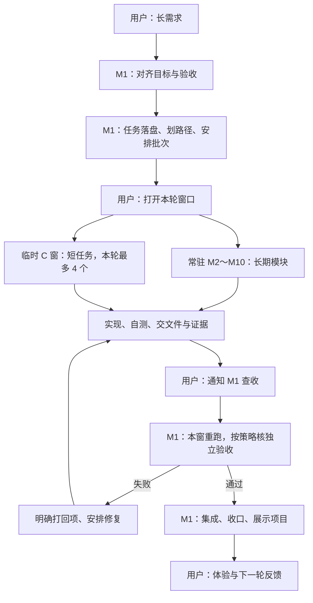

# Multi-Window M

**把长需求交给 M1，让多个 AI 窗口分工推进，用真实验收收口。**

适合持续数天、数周的开发项目：游戏、网站、工具，以及有明确文件和验收标准的长期任务。

> **当前推荐基线：0.33。** 默认分支已恢复本地保留的 Codex 0.33，另附 DSH 0.33 适配版。0.34～0.36 后续迭代按维护者决定退出推荐范围，不能因版本号更大而视为升级。历史保留供追溯，见 [版本说明](VERSION-POLICY.md)。

[独立安装包](https://github.com/tmddwyaaa-source/multi-window_M/releases/latest) · [下载当前仓库](https://github.com/tmddwyaaa-source/multi-window_M/archive/refs/heads/main.zip) · [默认版规则](SKILL.md) · [DSH 适配版](compatibility/dsh/) · [复制话术](templates.md)

## 为什么创建它

多个聊天窗口往往互相看不见。开窗越多，任务传达、文件冲突、遗漏和交接也越难管理。最难发现的情况是：执行窗口说完成了，主窗口也放行了，直到用户体验时才发现小需求没做。

Multi-Window M 把这件事组织成可留下记录的工作流：

- **M1 管全局。** 对齐需求，拆任务、划路径、安排批次、查收和集成。
- **执行窗口各守一块。** 长期模块交给常驻 M 窗，临时工作交给 C 窗；独立部分并行推进。
- **完成有证据。** 工人交文件和自测结果，M1 在自己的窗口重跑验收。
- **长线可接班。** 需求、状态、边界、证据和下一步落盘，减少对聊天记忆的依赖。

效果应由真实项目衡量：你是否少操心、并行是否有效、遗漏是否减少。脚本 PASS 不等于游戏好玩或所有功能正确。

## 你实际怎么用

你可以一次写很长的需求，不必自己先拆任务：

> 我想给这个游戏加暂停、升级选项和存档；暂停时怪物和计时器都应停止；升级不能重复出现；存档需要能恢复。先看看你的理解，我们对齐后再开工。

1. **和 M1 对齐。** 必要的几轮对话确认目标、限制、必须项和验收方式。
2. **让 M1 安排。** 拆任务、登记模块和文件边界、安排本轮窗口；共享文件和强依赖分批做。
3. **按安排开窗。** 每个窗口加载同一适配版后，你只需说：“我是 M2，请完成指示任务。”窗口从同一项目的落盘材料/生成简报获取任务。
4. **通知查收。** 回到 M1 说：“M2、C1 已完成，请查收。”
5. **M1 验收与集成。** 重跑检查，按风险策略核对必要的独立验收；未通过则打回。整轮通过后收口，能打开时展示项目供你体验。

默认方式需要你开窗、传递完成信号；窗口不会自行叫醒 M1。“自动安排”指 M1 规划任务和批次，不是后台无人值守调度。



## 角色定位：按需开窗

**M1：项目主导窗口。** 对齐需求、规划、派工、处理冲突、验收和最终收口。默认负责管理与集成；亲自改子模块需用户点名同意。

**M2～M10：常驻模块窗口。** 维护战斗、界面、存档等长期模块。不必一次开齐所有编号，已完成模块无需常开。

**C1、C2……：临时窗口。** 处理一批数据、一个明确修复等短任务；本轮最多四个临时 C 窗，收口后关闭，下一轮号码可复用。

**斥候 / 主力 / 搜剿：工作阶段。** 不是三个新增部门。信息未知或冲突时只读调查；范围明确时直接实现；之后验收挑错。策略要求独立检查时，实现者不能兼任自己的独立验收者。

**用户：目标与体验的判断者。** 提需求、对齐方向、开窗传信号、体验结果。普通规划和资料编写交给 M1。

**脚本与 Hook：重复检查的辅助。** `taskctl.py` 管理状态、生成简报和运行检查。Hook 只是宿主事件触发器，不派工、不改状态、不标完成。

## 例子：游戏的一轮开发

这轮需要暂停、升级界面和存档：M1 先确认行为与接口，再安排 M2 改暂停逻辑、M3 改升级界面、C1 完成边界明确的存档任务。如果三者都改同一个入口文件，M1 应拆批次或让一个窗口主改，不能为了并行互相覆盖。

“暂停完成”的证据应覆盖计时和怪物行为，不能只查文件存在。M1 重跑后，你仍需打开游戏体验。这个例子展示分工，skill 本身不自带游戏功能。

## 0.33 的检查和返工

- 已确认需求映射到任务要求，避免只在聊天里承诺。
- 工人交文件、证据与可重跑命令；M1 本窗查收。
- 低风险且 `attempt < 2`、未强制独立验收的任务走短路径；其余按策略独立验收。
- 同一卡点绑定 `block_id`：第一次原负责人修复；第二次换真正不同的合格负责人并记交接；第三次硬停、写阻塞记录，交 M1 / 用户决定。
- 启用 `.task/` 后以其作为状态来源，状态文档由脚本生成。

0.33 已有独立验收策略，但**没有** 0.34 的 `assign-verifier` / `verifier_assignments` 双路由命令，也没有后续 `packet`、合同基线、`round-close` 功能。不要套用后续版本教程。

需求映射、路径边界和证据检查可发现部分错误；不保证发现全部未申报改动，也不保证识别低质量测试。实际验收须覆盖需求行为。

## 安装与兼容范围

### 选择一份安装

**Codex：默认版。** 使用根目录的 `SKILL.md`、`templates.md`、`CHANGELOG.md`、`scripts/`、`references/`，放到技能文件夹 `multi-window_M-0.33`，例如已有约定下的 `~/.codex/skills/multi-window_M-0.33/`。不要把嵌套的 `compatibility/` 一起安装。当前宿主采用其他发现路径时，应按其实际入口加载完整文件夹。

**DSH：独立适配版。** 复制 [compatibility/dsh/multi-window-m-033/](compatibility/dsh/multi-window-m-033/) 整个文件夹至 `~/.dsh/skills/`，保留目录名 `multi-window-m-033`。它是 0.33 加 DSH 接线适配和已记录补丁，不是 0.34。详见 [DSH 说明](compatibility/dsh/README.md)。

**Cursor：默认版的多窗口流程。** 可将默认文件集放入 `~/.cursor/skills/multi-window_M-0.33/` 并显式加载；有 Cursor Hook 历史说明，其中引用的外部适配器不在默认包内，需自行配置并验证。

**Zcode：默认流程与接线参考。** 按当前 Zcode 的实际技能安装方式加载默认文件集；保留 `zcode-stop` 约定。未在本次发布中验证当前宿主的完整闭环，不宣称自动安装或全面兼容。

“有基础流程或接线说明”不等于“四个平台所有版本全面实测”。默认从人工路由开始，仅在本窗确认能力后才用子代理协作。下载技能不会自动接上 Hook。

### 给 agent 的开场话术

安装完整文件夹，在同一项目主窗口明确加载所选版本，再说：

```text
请读取已安装的 Multi-Window M 0.33 skill。你是 M1。
先和我对齐需求，确认后自主拆任务和窗口批次。
窗口由我打开；不要假设能看到其他窗口的聊天。
完成后由你在本窗重跑验收，再集成和收口。
```

执行窗也加载同一适配版，然后说：

```text
我是 M2，请完成本轮指示任务。
```

详细话术见 [templates.md](templates.md)。项目资料由 M1 准备，不要求用户手填任务 JSON。

### Hook 和已有项目

默认版见 [hooks.md](references/hooks.md)，DSH 见 [专用接线说明](compatibility/dsh/multi-window-m-033/references/dsh-evidence.md)。历史配置须替换本机路径并验证实际事件；无有效 Hook 时走默认流程，不开启监督声明。

新项目可直接从 0.33 开始。**已被 0.34～0.36 修改的项目，不要直接用旧脚本覆盖或自动降级。** 本次恢复技能发布基线，没有新格式回退转换器。先备份，在副本核对任务状态和字段；已有新版本 Hook 也不会自动切换。

## 工具入口（给 M1 / 维护者）

需要 Python 3；Git 项目可用相关工作区检查。原脚本和测试采用 Windows `py -3` 启动方式，其他系统需按环境调整，不宣称本次已全面验证跨平台。

```text
# 在默认版目录自检
py -3 scripts/taskctl.py selftest

# 以下假设 M1 已准备项目任务；--root 在子命令之前
py -3 scripts/taskctl.py --root <项目根> brief TASK-001 --role worker
py -3 scripts/taskctl.py --root <项目根> gate TASK-001
py -3 scripts/taskctl.py --root <项目根> status --markdown --write
py -3 scripts/taskctl.py --root <项目根> handoff
```

`gate TASK-001` 为完整检查，`--basic` 为基础检查。策略和完整状态路径见 [task-gate.md](references/task-gate.md)。脚本自检不代替真实多窗口验证。

## 它属于什么、适合什么

主体是**工作流**：规定需求怎样走到完成；多窗口 / 多 agent 提供分工；脚本和 Hook 承担部分自动化。默认不自动开窗、不负责无人值守上线。

适合长期、模块边界明确、会追加需求或换窗接班的项目。一次小修改通常无需整套流程；没有验收标准的纯主观工作，也很难用机械检查判断质量。

本次只恢复 0.33 与整理分发，没有加入后续规则。旧格式沙盒及嵌入脚本移出默认下载，在 Git 历史保留，避免被误当成当前正例。

## 文件导航

- [SKILL.md](SKILL.md)：默认版 0.33 规则。
- [templates.md](templates.md)：开场、派工、查收、交接话术。
- [scripts/taskctl.py](scripts/taskctl.py)：原 0.33 任务和检查工具。
- [task-gate.md](references/task-gate.md)：状态、策略、证据与命令。
- [hooks.md](references/hooks.md)：历史宿主接线参考。
- [performance.md](references/performance.md)：效率试验，不作为已证明收益。
- [DSH 适配版](compatibility/dsh/)：独立安装包与说明。
- [VERSION-POLICY.md](VERSION-POLICY.md)：来源、撤回版本与兼容边界。
- [CHANGELOG.md](CHANGELOG.md)：本次恢复记录和 0.33 及更早历史。

请勿提交密钥、个人聊天记录或 Hook 日志。报告问题时注明适配版、宿主和项目版本。
