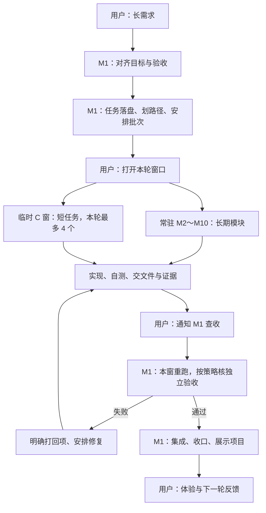

# Multi-Window M

**把长需求交给 M1，让多个 AI 窗口分工推进，用真实验收收口。**

适合持续数天、数周的开发项目：游戏、网站、工具，以及有明确文件和验收标准的长期任务。

> **当前推荐基线：0.33。** 默认分支已恢复本地保留的 Codex 0.33，另附 DSH 0.33 适配版。0.34～0.36 后续迭代按维护者决定退出推荐范围，不能因版本号更大而视为升级。历史保留供追溯，见 [版本说明](VERSION-POLICY.md)。

[独立安装包](https://github.com/tmddwyaaa-source/multi-window_M/releases/latest) · [下载当前仓库](https://github.com/tmddwyaaa-source/multi-window_M/archive/refs/heads/main.zip) · [默认版规则](SKILL.md) · [DSH 适配版](compatibility/dsh/) · [复制话术](templates.md)

**阅读顺序：** [为什么需要](#为什么创建它) → [适合什么](#适用场景与能力范围) → [怎么使用](#你实际怎么用) → [谁负责什么](#角色定位按需开窗) → [内部机制](#核心机制任务怎样被确认完成) → [安装](#安装与兼容范围) → [工具命令](#工具入口给-m1--维护者)。

第一次使用先看前四部分；想了解任务状态、验收和返工如何运作，再看内部机制。下面的字段和命令主要由 M1 / 执行窗口操作，不要求用户逐项手填。

## 为什么创建它

多个聊天窗口往往互相看不见。开窗越多，任务传达、文件冲突、遗漏和交接也越难管理。最难发现的情况是：执行窗口说完成了，主窗口也放行了，直到用户体验时才发现小需求没做。

Multi-Window M 把这件事组织成可留下记录的工作流：

- **M1 管全局。** 对齐需求，拆任务、划路径、安排批次、查收和集成。
- **执行窗口各守一块。** 长期模块交给常驻 M 窗，临时工作交给 C 窗；独立部分并行推进。
- **完成有证据。** 工人交文件和自测结果，M1 在自己的窗口重跑验收。
- **长线可接班。** 需求、状态、边界、证据和下一步落盘，减少对聊天记忆的依赖。

效果应由真实项目衡量：你是否少操心、并行是否有效、遗漏是否减少。脚本 PASS 不等于游戏好玩或所有功能正确。

## 适用场景与能力范围

它的主体是**工作流**：规定任务从需求、分工、实现到验收完成的过程。多个 agent 窗口承担分工；脚本和 Hook 为部分重复操作提供自动化。三者组合的目标是持续推进项目。

适合这些情况：

- **长期开发与持续维护。** 游戏、网站、工具逐轮增加功能，做完一轮还会接着改。
- **一大段需求含多个模块。** M1 帮你拆分，安排能并行的部分和必须等待的依赖。
- **窗口上下文彼此隔离。** 用同一项目的文件、简报和回执交接，不假设窗口能互读聊天。
- **任务容易漏项或反复返工。** 把需求、证据、状态和失败历史对应起来。
- **隔天继续或更换 agent。** 用接班简报恢复全局，不用从聊天里重新拼项目现状。

一次对话能完成的小修改通常不需要整套多窗口安排；但长期项目里的小任务也不能因为小就免验。纯主观创作需要人先定义可接受标准，机械检查不能代替审美判断。

**它能组织有边界的并行，不负责替你决定产品方向，也不是无人值守的任务调度或自动上线服务。** 增加窗口不一定更快：任务之间的文件和接口依赖，才决定能否并行。

## 你实际怎么用

你可以一次写很长的需求，不必自己先拆任务：

> 我想给这个游戏加暂停、升级选项和存档；暂停时怪物和计时器都应停止；升级不能重复出现；存档需要能恢复。先看看你的理解，我们对齐后再开工。

1. **和 M1 对齐。** 必要的几轮对话确认目标、限制、必须项和验收方式。
2. **让 M1 安排。** 拆任务、登记模块和文件边界、安排本轮窗口；共享文件和强依赖分批做。
3. **按安排开窗。** 每个窗口加载同一适配版后，你只需说：“我是 M2，请完成指示任务。”窗口从同一项目的落盘材料/生成简报获取任务。
4. **通知查收。** 回到 M1 说：“M2、C1 已完成，请查收。”
5. **M1 验收与集成。** 重跑检查，按风险策略核对必要的独立验收；未通过则打回。整轮通过后收口，能打开时展示项目供你体验。

默认方式需要你开窗、传递完成信号；窗口不会自行叫醒 M1。“自动安排”指 M1 规划任务和批次，不是后台无人值守调度。



## 角色定位：按需开窗

**M1：项目主导窗口。** 对齐需求、规划、派工、处理冲突、验收和最终收口。默认负责管理与集成；亲自改子模块需用户点名同意。

**M2～M10：常驻模块窗口。** 维护战斗、界面、存档等长期模块。不必一次开齐所有编号，已完成模块无需常开。

**C1、C2……：临时窗口。** 处理一批数据、一个明确修复等短任务；本轮最多四个临时 C 窗，收口后关闭，下一轮号码可复用。

**斥候 / 主力 / 搜剿：工作阶段。** 不是三个新增部门。斥候做只读调查，主力做实现，搜剿负责挑错；一个窗口可在不同阶段采用不同工作方式。策略要求独立检查时，实现者不能兼任自己的独立验收者。

**用户：目标与体验的判断者。** 提需求、对齐方向、开窗传信号、体验结果。普通规划和资料编写交给 M1。

**脚本与 Hook：重复检查的辅助。** `taskctl.py` 管理状态、生成简报和运行检查。Hook 只是宿主事件触发器，不派工、不改状态、不标完成。

`worker` 是实现职责，`verifier` 是独立验收职责，`owner` 是任务当前负责窗口的字段。它们不是 M/C 之外的第三套窗号。合法窗号为 M1～M10 和 C 加正整数；“本轮最多四个 C 窗”是数量限制，不意味着编号只能叫 C1～C4。文件名和 TASK 编号也不当作窗号。

## 一轮项目会留下什么

M1 将对齐后的需求变成模块、路径、任务和验收方法。常驻模块先明确接口和骨架，再安排独立部分并行；同一文件原则上由一个任务主改。出现共享入口或配置冲突，由 M1 协调批次与集成。

例如暂停、升级界面、存档三个模块：M2 改暂停逻辑，M3 改升级界面，C1 做一个有明确边界的存档任务；若都碰同一入口，先分批或指定一个窗口主改。“暂停完成”的证据要覆盖计时和怪物行为，而不是只查文件存在。以下是协作记录的用途，不是 skill 自带的游戏功能：

```text
项目/
├─ docs/
│  ├─ MODULE-REGISTRY.md   模块、路径、交付物与验收方法
│  ├─ TASK-STATUS.md       启用任务控制后生成的状态视图
│  ├─ RECEIPT-LOG.md       M1 查收过程与重跑记录
│  ├─ FIX-PLAN.md          修复分工与后续计划
│  └─ BLOCKERS/           需要升级处理的卡点报告
└─ .task/                 启用脚本任务控制后使用
   ├─ round.json          本轮窗口、任务、回执、能力与监督声明
   └─ TASK-001/
      ├─ manifest.json       需求、负责人、边界、风险、任务状态和历史
      ├─ worker-report.json  实现者的覆盖项、改动、自测与已知缺口
      ├─ verify-report.json  独立验收材料（按策略需要）
      ├─ rerun.json          Full Gate 实际重跑记录
      └─ evidence/           逐项证据
```

**基础协作与脚本任务控制是两个层次。** 没有 `.task/` 时也可按 M1 分工、工人交付、M1 本窗重跑的流程协作；启用 `.task/` 后才有下面的结构化状态、覆盖检查和整轮审计。安装 skill 不会自动生成已填好的任务，`init` 只给骨架，M1 必须把需求、边界和验收方法填实。

## 核心机制：任务怎样被确认完成

0.33 不只是窗口编号和派工话术。它还包含任务状态机、需求覆盖、分层门禁、独立验收、整轮检查、返工历史和接班机制。下面按原版实际实现说明。

### 1. 任务状态与窗口状态分开

“M2 已交付”与“任务已验收完成”是两件事。

- **任务状态**存在 `.task/TASK-001/manifest.json`：任务目前处于哪个步骤。
- **窗口状态**存在 `.task/round.json` 的 `window_status`：本轮哪些窗口已经送达查收信号。
- **人看的状态表**是 `docs/TASK-STATUS.md`，由脚本生成。Registry 管模块和路径，查收日志记录过程，不能另写状态覆盖任务事实。

因此，用户说“M2 已完成”只让 M1 开始查收，不等于可以直接把 TASK-001 标成最终完成。

### 2. 状态机：实现完成、验收通过、集成完成各有一步

常用状态及中文含义：

- `pending`：待开始。
- `in_progress`：施工中。
- `worker_done`：执行者已交付，等待后续查收。
- `verifying`：独立验收中。
- `verified`：独立验收已通过，仍未集成收口。
- `integrated`：M1 已集成。
- `done`：M1 最终收口。
- `reopened`：任务被重新打开；`paused` 是暂停，`blocked` 是阻塞。

策略决定两条路径，不能随意跳步骤：

```text
低风险、attempt < 2、没有强制独立验收：
pending → in_progress → worker_done → integrated → done

中高风险、attempt >= 2、或明确要求独立验收：
pending → in_progress → worker_done → verifying → verified → integrated → done
```

`attempt` 是任务累计重开次数，不是每次运行测试的次数。低风险小任务仍要过门禁，只是满足条件时可以少一段独立验收。

由 `verification_policy()` 统一决定路径。风险与显式策略自相矛盾时报 `POLICY_CONFLICT`，不能临时挑更容易通过的路线。角色参数也受检查：工人交 `worker_done`，验收者交验证状态，M1 才能 `integrated` / `done`；进入 `verified`、`integrated`、`done` 前脚本重跑 Full Gate。

这些是工具协议，不是操作系统权限隔离。手改 JSON 或伪造角色参数不能被当作可信交付方式；实际执行仍需遵守分工。

### 3. 需求覆盖：原话要落到可验收项目

用户需求保存在 `source_refs`，再通过 `maps_to` 对应任务中的 R1、R2 等要求。每个 R 项还要有验证方法；工人报告中需列出已覆盖要求和对应证据。

例如“暂停后怪物和计时器都停止”，应拆成至少能分别验证两个行为的要求。不能只做怪物停下，就把整句标成完成。

脚本检查映射、编号、报告覆盖与证据条目是否齐全；缺映射会报 `REQUIREMENT_COVERAGE_FAIL`。它能抓“漏安排、漏报告”，不会自动理解每项行为是否真的实现，测试和独立验收还要继续验证内容。

### 4. G0～G3 门禁：检查什么

“门禁”就是没有满足前提时，工具拒绝相关验收或完成转换。

- **G0，材料存在。** 核任务清单、工人报告；策略要求独立验收时还需验收报告。
- **G1，要求覆盖。** 检查 R 编号、工人声明的覆盖项、对应证据条目，未完成的 `known_gaps` 不能带着过关。
- **G2，真实重跑与文件检查。** Full Gate 执行可识别的 `verify_cmd`、可执行 `verify` 与报告中的测试命令，检查退出码；核证据路径真实存在且不逃出项目；检查申报改动是否在 `allowed_paths` 内，有 Git 时核允许范围内是否存在漏申报改动。结果写进 `rerun.json`。
- **G3，独立验收。** 需要时核 `verify-report.json`：验收者不能与工人窗口相同，结果须通过、检查项须覆盖要求、不能有缺项。

`gate TASK-001 --basic` 是基础材料检查，不重跑命令；`gate TASK-001` 是完整验收。**基础通过不等于完整通过；独立验收通过也不等于已集成完成。**

边界如实说明：G2 不保证扫描并归属整个项目的所有越界改动；G3 是 0.33 的报告级独立性检查，没有后续 0.34 的正式双路由绑定。测试如果只打印成功，工具也无法据此证明真实功能正确。

### 5. 整轮检查：不是一个窗口通过就全局完成

`round.json` 记录本轮窗口、窗口对应任务、回执和窗口状态。M1 收到信号后记 receipt；准备检查时设置 `check_requested`，再运行 `audit-round`。

整轮检查核对：

- 本轮窗口名单与状态是否匹配，回执是否齐全。
- 需求映射、能力挡位和已声明子代理绑定是否有效。
- 每项任务的基础门禁、必要独立验收和 Full Gate 是否通过。
- 若明确开启 Hook 监督，是否有有效宿主事件证据。

未齐会输出 `ROUND_NOT_READY`；通过时出现 `BASIC_GATE_PASS`、`FULL_GATE_PASS`、`ROUND_READY_TO_CLOSE`，再由 M1 按合法路径收口。**AUDIT SKIP、单个 RESULT PASS、或退出码为 0 都不能单独当整轮已完成。**

0.33 没有自动归档整轮的 `round-close` 命令，整轮审计与 M1 最终收口应区分。

### 6. 失败治理：避免原地盲改

`block_id` 标识同一卡点，`block_history` 记录失败，`assignment_history` 追加负责人交接。`owner` 是当前负责窗口的字段，不是另一个角色。

第一次同根因失败由原负责人修复；第二次要求真正换人并留下历史；第三次进入硬停和阻塞记录，交 M1 / 用户决定。换人不重置任务累计 `attempt`；不能仅换根因编号逃避计数。没有合格替代窗口时记录 `NO_ELIGIBLE_REPLACEMENT_WORKER`，不能假装换人。

这是 0.33 的设计规则与已有记录机制，不意味着已穷尽验证所有绕过路径。

### 7. Hook、能力挡位和子代理检查

默认采用人工路由 P；额外能力未经本窗确认，不能自报加分或启用 A 协作。虚报能力会触发 `GEAR_VIOLATION`。

Hook 启用后可记录宿主 Stop 的成对 start/end、来源和 run_id；声明 `hook_supervision=true` 却缺有效证据，会触发 `HOOK_EVIDENCE_MISSING`。手动检查不能冒充自动触发。Hook 不派工、不改状态、不标 done，也不能代替 M1 复跑。

使用子代理时记录任务、窗口、路径、职责和 run_id；脚本检查声明中的路径冲突、重复绑定、实现者兼验收者等，触发 `PARALLEL_FAIL` 时不能按有效整轮收口。它不是文件锁，不能保证阻止所有真实并发写入。DSH 版另有正式角色限制，按专用说明使用。

### 8. 简报、状态视图与接班

`brief` 按任务和职责生成可复制的指示，包含负责人、边界、要求、验收策略和报告约定。M1 把生成物交给执行窗，不临时口述另一套版本。它负责生成说明，不会自动送达另一个窗口。

`status` 查看窗口与任务两种状态；`status --markdown --write` 生成状态表。`handoff` 则给新 M1 汇总本轮名单、已收回执、迁移信息、任务现状、未闭环项、阻塞报告、Hook 摘要和下一步建议。

换模型、换主窗口或中断后恢复时，新 M1 先读取接班材料，再核实际文件和重跑验收。简报不能替代验证，也不会保证未记录的需求自动找回。

### 9. 按需探索与回报节奏

0.33 的效率思路是减少重复探索和重复复述，同时保留必要的需求对齐和验收：

- 路径、接口与影响已知时，主力最小确认后实现，不固定开斥候。
- 路径已知但影响不清时，用微型斥候查关键依赖；路径未知、登记过期或文档冲突时，再做受限只读调查。
- 斥候交路径、行号、约束和最小建议范围，主力不重新大范围搜索。
- M1 在需求对齐、正式派工、异常与收口时传达新的控制信息，普通进度不反复重讲背景。
- 大段输出完整保存在证据文件，聊天传结论、路径和关键片段；重要失败不能为了缩短回报而省略。

这些原则与具体预算不同：短回执行数、大文件读取阈值等在 [performance.md](references/performance.md) 中仍是试验配置，需同宿主、同项目基线、同类任务比较。只有质量不降、返工不增，才值得固定；不能把节省文字当成省略需求沟通的理由。

### 10. 旧项目迁移有备份和检查

`migrate-project` 覆盖已有项目工具前先备份、写迁移报告和版本 lock，再用 `--check` 验证工具能运行、Hook 不改状态、负向路径仍被拒绝。`MIGRATE_READY` 仅代表这些迁移健康检查通过，**不代表项目所有任务已经完成**，也不提供后续版本格式的自动降级。

上述是 0.33 已保留的机制，不是本次新增设计。详细字段与命令见 [任务门禁说明](references/task-gate.md)。

## 怎样理解通过、失败与完成

- **材料齐全**：能开始验，不等于实现正确。
- **完整门禁通过**：当前声明的要求、可识别命令和证据检查通过，不等于覆盖所有现实问题。
- **独立验收通过**：另一职责的检查结论通过，仍可能漏验，也还没等于 M1 已集成。
- **整轮准备收口**：本轮审计满足前提，不会自动替 M1 将所有任务写成 done。
- **最终完成**：M1 按状态规则集成收口，用户再确认产品体验；发现遗漏可以重新打开任务。

用户仍需要判断玩法、交互、视觉和实际体验。这个 skill 的作用是让分工与检查有依据、让遗漏更容易暴露，不能承诺 agent 永不偷懒、门禁永不误报或每次 PASS 都代表产品完全正确。

后续 0.34 的双路由命令，以及 `packet`、合同基线、`round-close` 等后续功能不属于这里的 0.33。默认分发恢复基线，不等于把后续设计改名混入旧版。

## 安装与兼容范围

### 选择一份安装

**Codex：默认版。** 使用根目录的 `SKILL.md`、`templates.md`、`CHANGELOG.md`、`scripts/`、`references/`，放到技能文件夹 `multi-window_M-0.33`，例如已有约定下的 `~/.codex/skills/multi-window_M-0.33/`。不要把嵌套的 `compatibility/` 一起安装。当前宿主采用其他发现路径时，应按其实际入口加载完整文件夹。

**DSH：独立适配版。** 复制 [compatibility/dsh/multi-window-m-033/](compatibility/dsh/multi-window-m-033/) 整个文件夹至 `~/.dsh/skills/`，保留目录名 `multi-window-m-033`。它是 0.33 加 DSH 接线适配和已记录补丁，不是 0.34。详见 [DSH 说明](compatibility/dsh/README.md)。

**Cursor：默认版的多窗口流程。** 可将默认文件集放入 `~/.cursor/skills/multi-window_M-0.33/` 并显式加载；有 Cursor Hook 历史说明，其中引用的外部适配器不在默认包内，需自行配置并验证。

**Zcode：默认流程与接线参考。** 按当前 Zcode 的实际技能安装方式加载默认文件集；保留 `zcode-stop` 约定。未在本次发布中验证当前宿主的完整闭环，不宣称自动安装或全面兼容。

“有基础流程或接线说明”不等于“四个平台所有版本全面实测”。默认从人工路由开始，仅在本窗确认能力后才用子代理协作。下载技能不会自动接上 Hook。

### 给 agent 的开场话术

安装完整文件夹，在同一项目主窗口明确加载所选版本，再说：

```text
请读取已安装的 Multi-Window M 0.33 skill。你是 M1。
先和我对齐需求，确认后自主拆任务和窗口批次。
窗口由我打开；不要假设能看到其他窗口的聊天。
完成后由你在本窗重跑验收，再集成和收口。
```

执行窗也加载同一适配版，然后说：

```text
我是 M2，请完成本轮指示任务。
```

详细话术见 [templates.md](templates.md)。项目资料由 M1 准备，不要求用户手填任务 JSON。

### Hook 和已有项目

默认版见 [hooks.md](references/hooks.md)，DSH 见 [专用接线说明](compatibility/dsh/multi-window-m-033/references/dsh-evidence.md)。历史配置须替换本机路径并验证实际事件；无有效 Hook 时走默认流程，不开启监督声明。

新项目可直接从 0.33 开始。**已被 0.34～0.36 修改的项目，不要直接用旧脚本覆盖或自动降级。** 本次恢复技能发布基线，没有新格式回退转换器。先备份，在副本核对任务状态和字段；已有新版本 Hook 也不会自动切换。

## 工具入口（给 M1 / 维护者）

需要 Python 3；Git 项目可用相关工作区检查。原脚本和测试采用 Windows `py -3` 启动方式，其他系统需按环境调整，不宣称本次已全面验证跨平台。

```text
# 在默认版目录自检
py -3 scripts/taskctl.py selftest

# 以下假设 M1 已准备项目任务；--root 在子命令之前
py -3 scripts/taskctl.py --root <项目根> brief TASK-001 --role worker
py -3 scripts/taskctl.py --root <项目根> gate TASK-001
py -3 scripts/taskctl.py --root <项目根> status --markdown --write
py -3 scripts/taskctl.py --root <项目根> handoff
```

`gate TASK-001` 为完整检查，`--basic` 为基础检查。策略和完整状态路径见 [task-gate.md](references/task-gate.md)。脚本自检不代替真实多窗口验证。

<details>
<summary>展开：0.33 全部工具入口与各自用途</summary>

这些命令由 M1 / 对应执行者使用。下方是分类示例，不是一段可以从上到下一次执行的安装脚本；其中任务内容、路径和验收材料必须先由 M1 准备。

**创建任务、安排本轮与生成指示**

```text
py -3 scripts/taskctl.py --root <项目根> init TASK-001 --owner M2 --risk medium
py -3 scripts/taskctl.py --root <项目根> round-init ROUND-001 M2 C1 --task M2=TASK-001
py -3 scripts/taskctl.py --root <项目根> brief TASK-001 --role worker
py -3 scripts/taskctl.py --root <项目根> brief TASK-001 --role scout
py -3 scripts/taskctl.py --root <项目根> brief TASK-001 --role verifier
```

`init` 只建待填写骨架；`round-init` 登记名单和任务，已有 round 文件时拒绝覆盖。不能靠反复执行它开始下一轮。0.33 没有自动关闭旧轮的命令，M1 应在核验归档后管理下一轮，不能删未完成轮次来绕过检查。

**收信号、请求整轮检查与查看结果**

```text
py -3 scripts/taskctl.py --root <项目根> receipt M2
py -3 scripts/taskctl.py --root <项目根> request-check
py -3 scripts/taskctl.py --root <项目根> gate TASK-001 --basic
py -3 scripts/taskctl.py --root <项目根> gate TASK-001
py -3 scripts/taskctl.py --root <项目根> audit-round
py -3 scripts/taskctl.py --root <项目根> status
py -3 scripts/taskctl.py --root <项目根> status --markdown --write
```

`receipt` 记录名单内窗口的查收信号；`request-check` 把检查请求设为 true，不能替代其余回执或验证。`audit` 是 `audit-round` 的既有别名。

**按角色推进任务**

```text
py -3 scripts/taskctl.py --root <项目根> transition TASK-001 in_progress --actor M1
py -3 scripts/taskctl.py --root <项目根> transition TASK-001 worker_done --actor worker
py -3 scripts/taskctl.py --root <项目根> transition TASK-001 verifying --actor verifier
py -3 scripts/taskctl.py --root <项目根> transition TASK-001 verified --actor verifier
py -3 scripts/taskctl.py --root <项目根> transition TASK-001 integrated --actor M1
py -3 scripts/taskctl.py --root <项目根> transition TASK-001 done --actor M1
```

独立验收两步仅在策略需要时使用；低风险短路径跳过这两步。pause/block 等状态用实际合法目标 `paused` / `blocked` 处理。完成转换不代替 M1 依工作流完成整轮审计。

**打回、真换人、接班与自检**

```text
py -3 scripts/taskctl.py --root <项目根> reopen TASK-001 --block-id BLOCK-UI --reason "发现遗漏" --actor M1
py -3 scripts/taskctl.py --root <项目根> reassign TASK-001 --owner C1 --reason "第二次同根因失败后交接" --actor M1
py -3 scripts/taskctl.py --root <项目根> handoff
py -3 scripts/taskctl.py selftest
```

`reassign` 用于第二次同根因失败已要求换人时，也可在第二次 `reopen` 时给 `--new-owner C1`。替代负责人须是不同的合法 M/C 窗并在本轮名单中；第一轮返工不传 `--new-owner`。真正换根因需用 `--new-root-cause` 留下依据。

**迁移与 Hook**

```text
py -3 <本技能目录>/scripts/taskctl.py --root <项目根> migrate-project --destination scripts/taskctl.py --force
py -3 <本技能目录>/scripts/taskctl.py --root <项目根> migrate-project --check
py -3 scripts/taskctl.py --root <项目根> hook-audit --source manual
```

迁移前备份；`--force` 不是无条件安全回退。最后一条只作人工诊断，不能当自动事件证据。宿主 Stop 来源由实际适配器传入；DSH 额外的桥接参数与事件见其专用参考。

</details>

## 版本与验证范围

本次恢复的默认版 10 套脚本自检、DSH 版 11 套自检通过，核心脚本与本地保留来源哈希一致。没有重做四宿主真实多窗口项目测试，也没有自动切换你电脑上的技能或 Hook。

通用技能格式校验因当前 Python 缺 PyYAML 未完成；原版名称、frontmatter 与行为保持，不宣称通过当前格式校验。详细来源和校验范围见 [VERSION-POLICY.md](VERSION-POLICY.md)。

旧格式沙盒及嵌入脚本移出默认下载，在 Git 历史保留。0.34～0.36 标为不推荐，历史可恢复。后续若优化应另建隔离版本，并以真实项目的少操心、少返工和少遗漏判断效果。

## 文件导航

- [SKILL.md](SKILL.md)：默认版 0.33 规则。
- [templates.md](templates.md)：开场、派工、查收、交接话术。
- [scripts/taskctl.py](scripts/taskctl.py)：原 0.33 任务和检查工具。
- [task-gate.md](references/task-gate.md)：状态、策略、证据与命令。
- [hooks.md](references/hooks.md)：历史宿主接线参考。
- [performance.md](references/performance.md)：效率试验，不作为已证明收益。
- [DSH 适配版](compatibility/dsh/)：独立安装包与说明。
- [VERSION-POLICY.md](VERSION-POLICY.md)：来源、撤回版本与兼容边界。
- [CHANGELOG.md](CHANGELOG.md)：本次恢复记录和 0.33 及更早历史。

请勿提交密钥、个人聊天记录或 Hook 日志。报告问题时注明适配版、宿主和项目版本。
